# 素不莳花 · 同济大学植物资源

[](https://nephelium.github.io/Plant-Resources-of-Tongji/#/)

[nephelium.github.io/Plant-Resources-of-Tongji](https://nephelium.github.io/Plant-Resources-of-Tongji/#/)

**和草木打个招呼，校园就多一位老朋友。**

一份可以沿着地图阅读的校园植物图鉴。这里收录了同济大学四平路校区的植物调查点位、分类资料、植物照片和自然手记，希望让每天经过的树与花，多一个被认出的机会。

[当前线上网站](https://nephelium.github.io/Plant-Resources-of-Tongji/#/) · [快速开始](#快速开始) · [页面与功能](#页面与功能) · [数据与资源](#数据与资源) · [开发与验证](#开发与验证)

> 下方为 2026-10-21 本地改版的真实浏览器截图。线上网站的内容取决于最后一次发布。

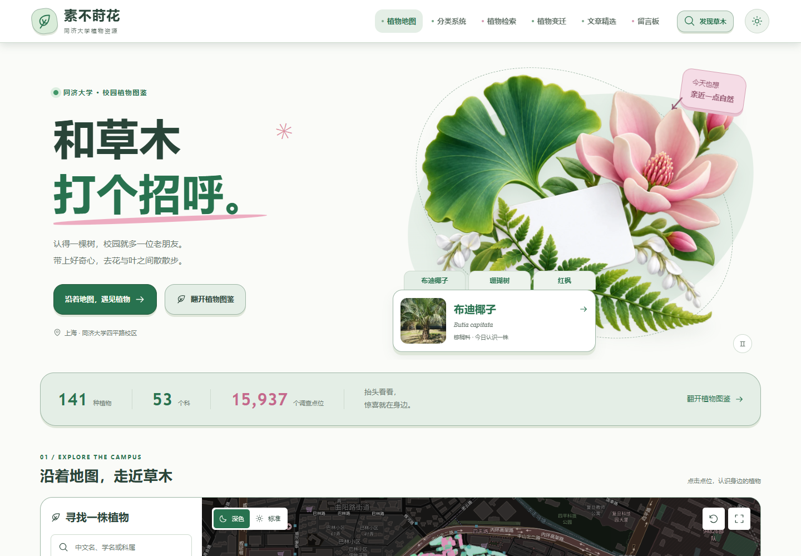

## 设计与交互

参考 [PhoneticToolbox](https://www.phonetictoolbox.com/) 的圆润导航、立体按钮与轻盈卡片，使用叶绿、深绿与白色，并用少量花瓣粉点缀，让校园植物图鉴更有散步时的闲适感。

- **会动的植物插画**：银杏叶、花朵和蕨叶轻轻漂浮，鼠标经过时随指针小幅摆动，可手动暂停。
- **每天遇见不同植物**：首页与地图侧栏按北京时间每天选出三种植物，当天刷新保持一致。相识卡片每次进入随机选四种，还可以点击换一组。
- **照片一张张看**：拼接长图在页面中按单张照片展示，可左右滑动、点击放大。大图支持方向键、触摸切换、细节放大和 Esc 关闭。
- **明确的操作反馈**：按钮有抬起和按下效果，卡片悬停浮起，内容随滚动出现，页面切换轻柔过渡。
- **贴顶导航与夜间模式**：导航贴住窗口上沿，章节跳转和吸顶侧栏统一避让。外观默认随系统自动切换，顶栏太阳或月亮按钮可选择浅色、深色或跟随系统，并记住选择。
- **照顾不同使用习惯**：触控不触发鼠标倾斜，系统开启减少动画后停用装饰动画，功能仍正常使用。

首页装饰和 10 张文章专属封面由内置 GPT Image 绘制，真实植物照片和调查资料继续使用原资源。插画以 WebP 加载，原始 PNG 保留；这一组图片的网页传输体积较原稿减少约 89%。见 [插画文件与完整生成提示词](docs/illustrations.md)。

### 夜晚，也能舒服地看草木

夜间使用石墨灰底色与灰色卡片，以叶绿强调操作与重点。照片和插画保留本来的颜色，文章原有的彩色强调会适配深色纸面。系统切换外观时页面实时跟随，手动选择后优先采用你的设置，选回跟随系统即可恢复自动切换。

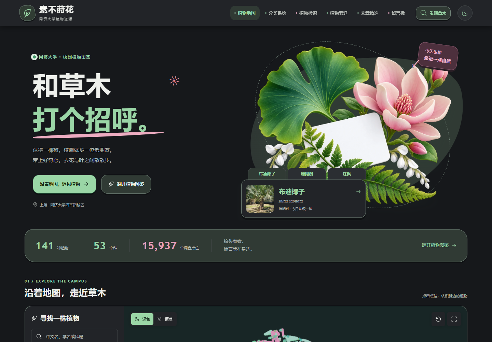

| 夜间植物图鉴                                                                             | 手机外观选择                                                                                                |
| ---------------------------------------------------------------------------------------- | ----------------------------------------------------------------------------------------------------------- |
| 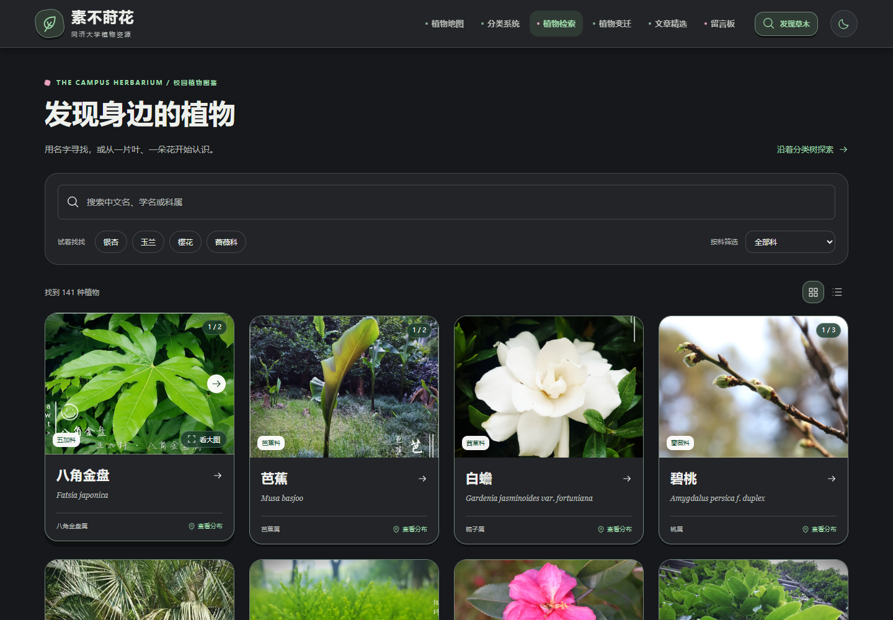 | 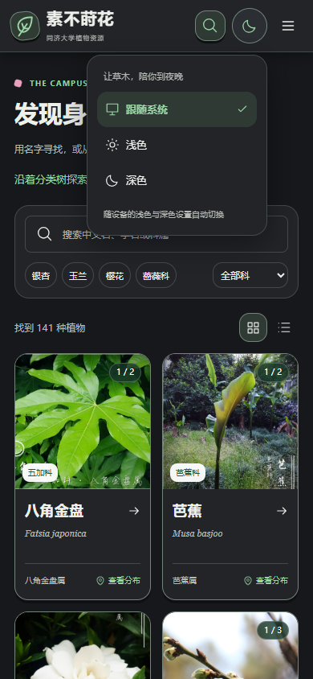 |

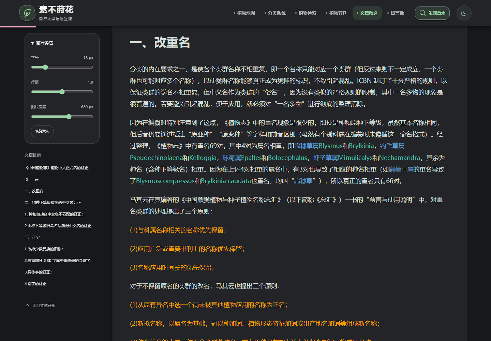

## 页面与功能

### 植物地图：把名字放回校园

地图底色跟随网站外观：日间使用浅色标准底图，夜间使用深色底图，植物按科着色。可输入中文名、学名或科属，也可用科筛选和常见植物快捷按钮缩小范围。侧栏列出对应植物及点位数量，点击箭头打开档案，点击地图上的点查看单株信息。

- 手动或系统切换日间／夜间外观时，地图同步切换底色。也可单独切换地图底色，下次网站外观变化时恢复跟随，保留 OpenStreetMap 署名。
- Canvas 绘制全部调查点位，避免创建上万个 SVG 节点。
- 支持缩放、平移、显示全部筛选点位、展开地图及 Esc 收起。
- 滚轮缩放默认开启，可在地图右下角取消勾选。
- 搜索条件保存在 URL 中，打开植物档案再返回时可继续浏览。
- 网络异常时保留点位，并提供底图重新加载按钮。

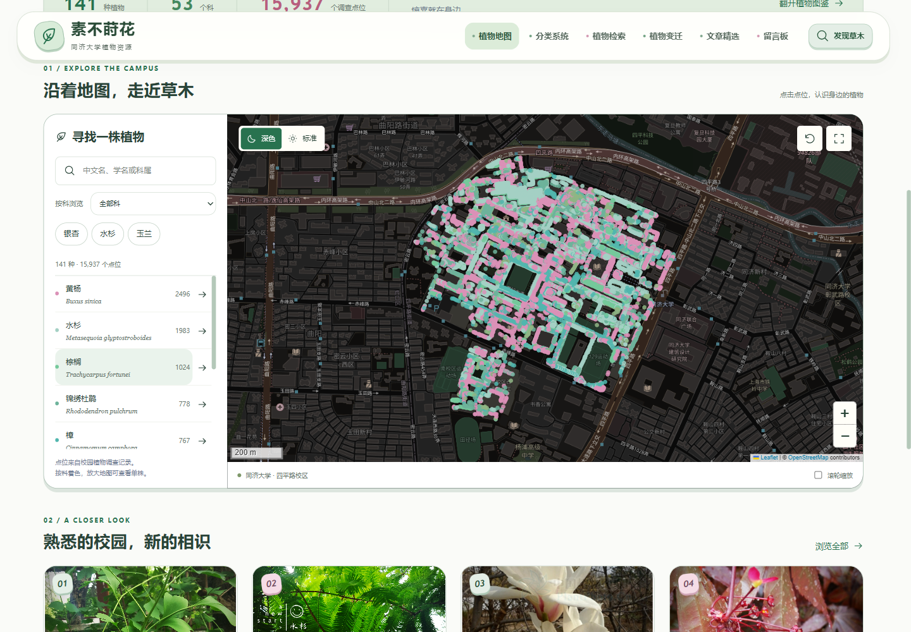

### 植物图鉴：搜索，也可以随意翻翻

首次打开即展示植物卡片。支持中文名、学名、科、属查询，多词查询按空格分隔，学名不区分大小写。名称搜索可与科筛选组合。

卡片和列表视图可切换，选择保存在当前浏览器中。结果按每页 24 种展示，页码写入地址栏。没有匹配结果时可一键清除筛选。

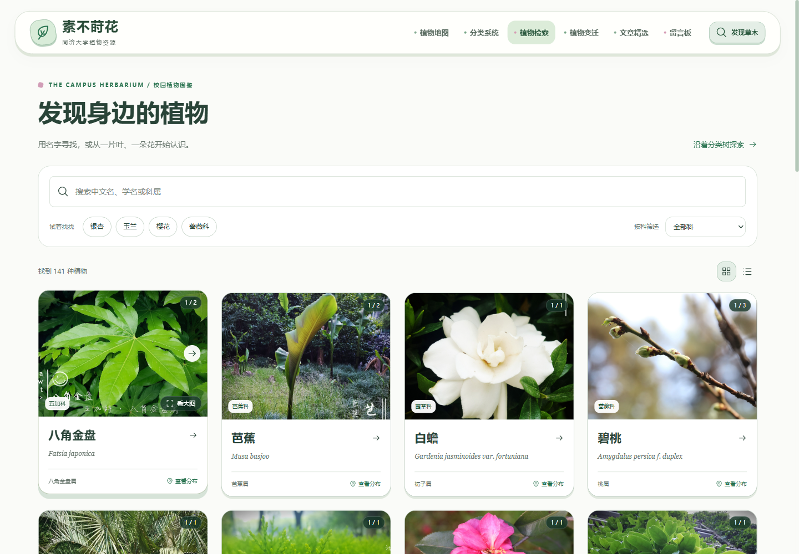

### 分类与档案：从科、属走到具体的一株

分类目录可以展开到科、属或种，也可以直接搜索目录。选中的植物会显示明确的选中状态，右侧打开照片、分类、花果期资料和分布地图。手机端选中植物后滚动到档案。

植物档案使用中文名作为主标题，学名单独排版。已有照片以完整比例展示，花期和果期缺少记录时明确标识。可以继续查看同科植物，或返回地图寻找它。

照片不会整张拼图挤在一个小框内。分类、档案、检索卡片和首页共用逐张图库，鼠标可拖动，手机可滑动；点击后打开完整大图，放大查看细节。

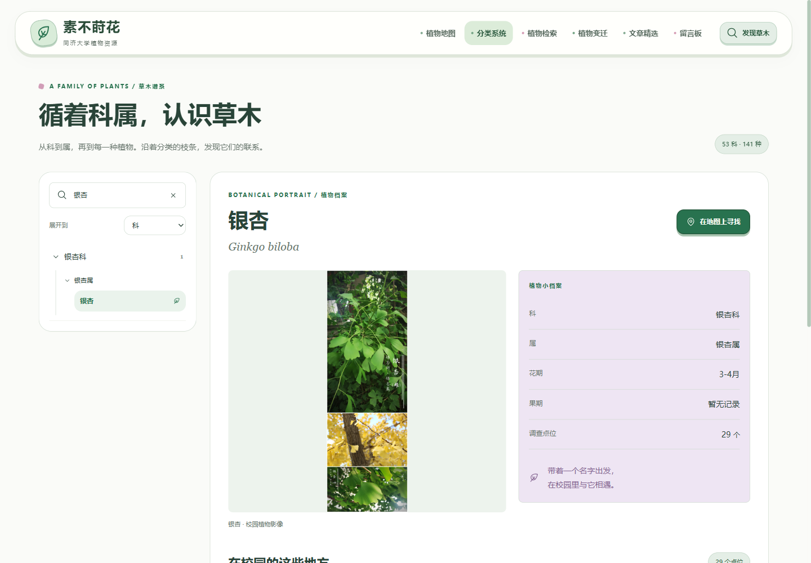

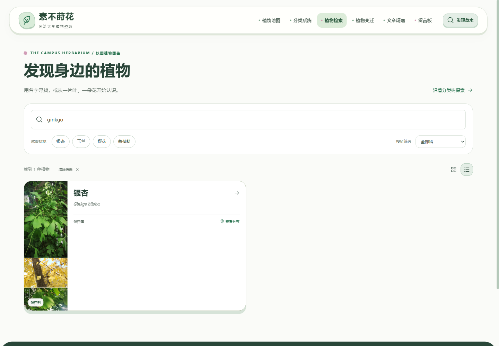

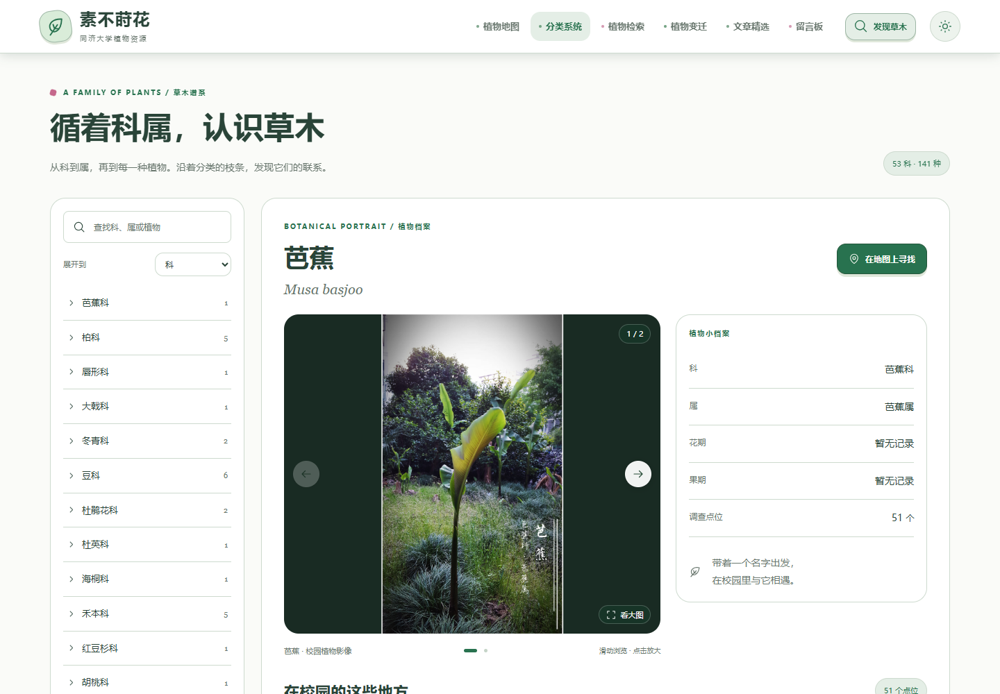

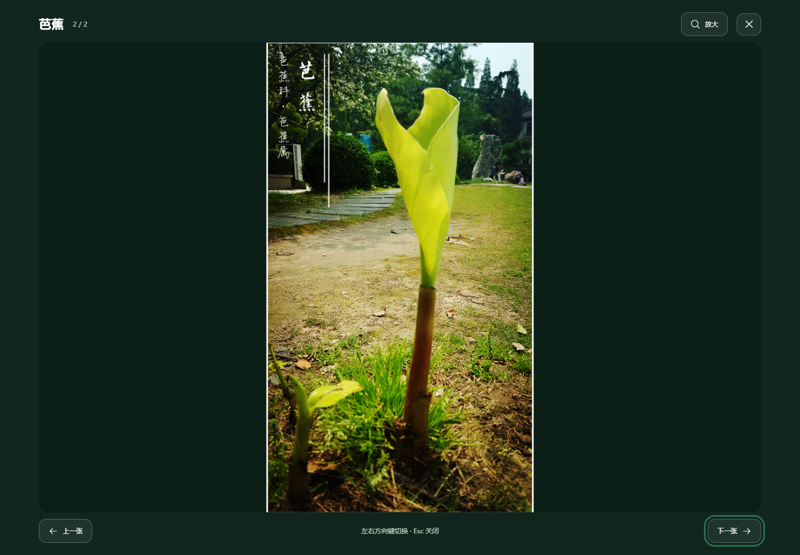

首页的相识卡片会随机选取新的植物，也可以随时换一组。

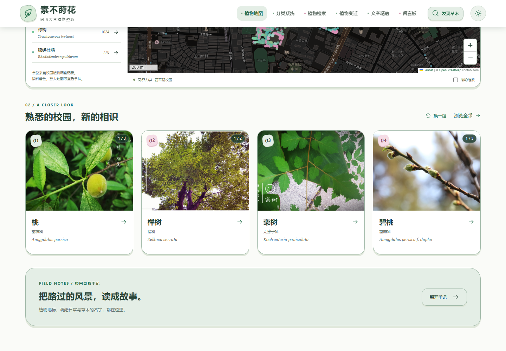

图库与每日选择的实现及维护方法见[照片浏览说明](docs/photo-galleries.md)。

### 文章精选：把路过的风景读成故事

通读全部 10 篇原有文章后，逐篇绘制了独立封面，分别呈现赏樱、植物地标、调绘、分类入门与命名学问。目录按校园手记、名字与学问分组，加入短简介，并以一篇校园故事作为醒目的开篇。目录支持标题搜索和主题筛选，文章有独立的可分享链接。

阅读页可调整字号、行距和图片宽度，也可恢复默认设置。参数在当前浏览器中保存。较长文章提供阅读进度和章节目录，表格在窄屏中可横向滚动。原文、图片和署名保留，页面统一处理原有固定字号与布局。

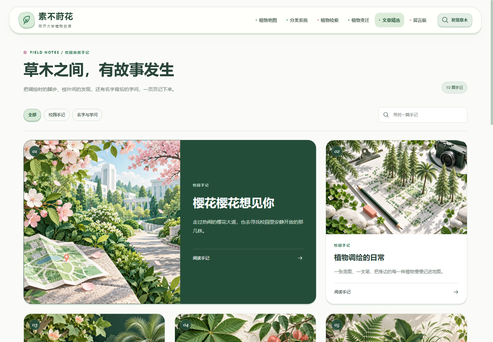

全部封面、逐篇内容提炼及生成提示词见 [文章封面画册](docs/article-covers.md)，也可查看[完整文章目录截图](output/playwright/screenshots/articles-gallery.png)。

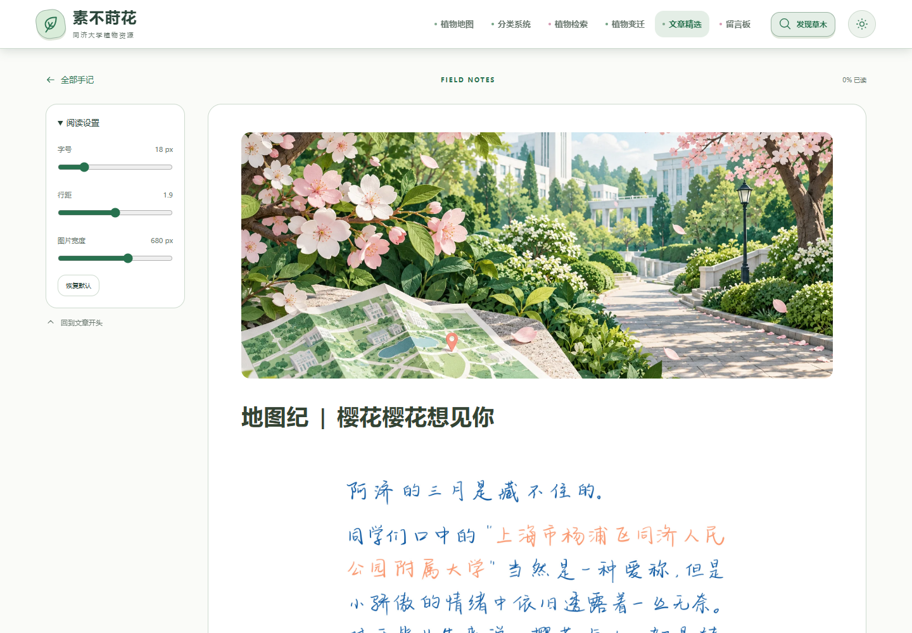

### 植物变迁：留下校园的年记

将原有记录按年份分组，支持年份筛选。保留调查日期、地点与原始内容。

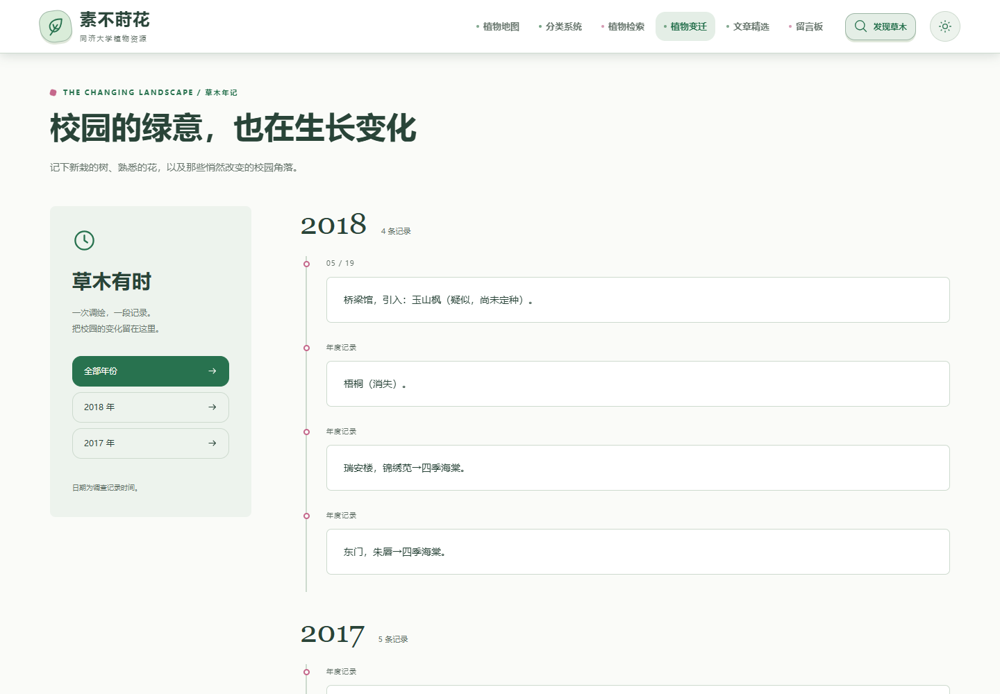

### 留言与交流

静态站以信笺和邮票为视觉元素，提供公众号二维码、邮件入口与复制邮箱。连接后端的动态模式提供留言、头像选择、回复和分页。表单包含必填、邮箱格式与长度校验，提交期间防止重复操作，提交失败时保留输入内容。


### 在手机上，也能慢慢看

导航在窄屏收起为菜单。地图筛选与地图上下排列，图鉴保持双列卡片，分类目录、档案和文章阅读区依次展开。提供键盘焦点、跳过导航、Esc 关闭和减少动画支持。

| 手机首页                                                                                     | 手机图鉴                                                                                  |
| -------------------------------------------------------------------------------------------- | ----------------------------------------------------------------------------------------- |
| 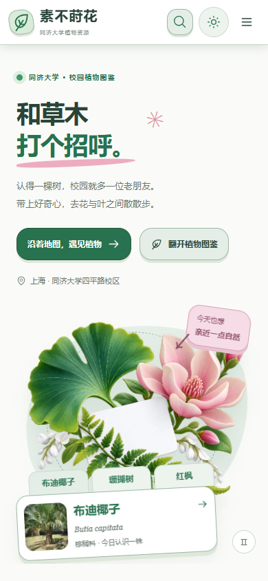         | 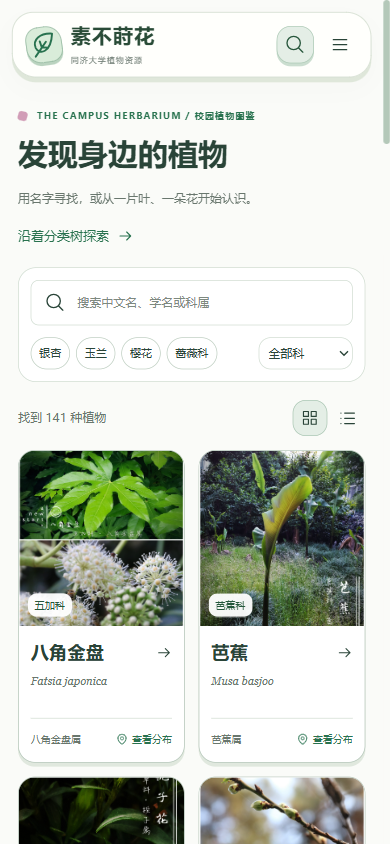    |
| 手机文章                                                                                     | 手机联系                                                                                  |
| 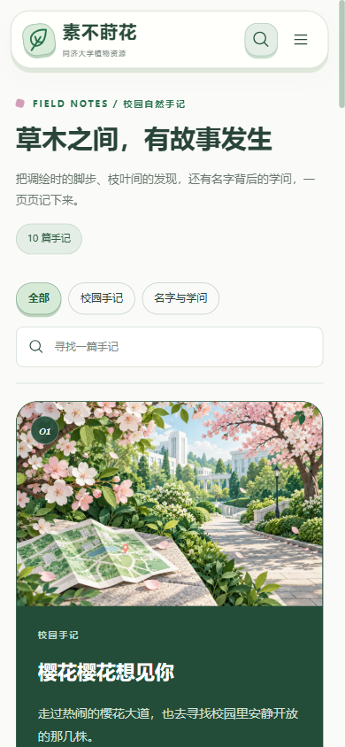 | 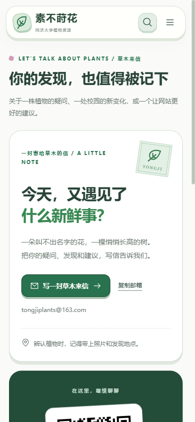 |

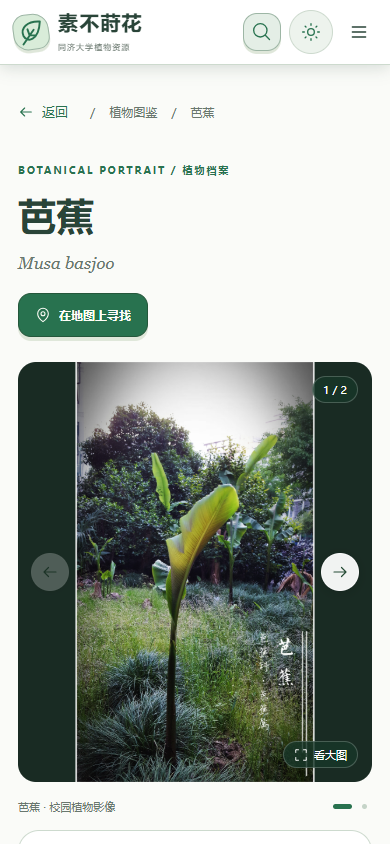

## 快速开始

建议使用 Node.js 24 LTS。本次验证环境为 Node.js 24.13.0，项目使用 npm 锁文件。

从当前前端目录运行：

```powershell
npm ci
npm run dev -- --mode static --host 127.0.0.1 --port 5173
```

打开 [本地预览](http://127.0.0.1:5173/)。

静态模式直接读取仓库中的植物数据、照片和文章，不需要启动后端。地图图块仍通过网络加载。

### 构建静态版

```powershell
npm run build:static
npm run preview -- --host 127.0.0.1 --port 4173
```

构建产物位于 `dist/`。静态版使用 Hash 路由，例如 `#/search` 和 `#/plant/银杏`。

若部署于子目录，可在当前 PowerShell 会话设置路径后构建：

```powershell
$env:VITE_APP_BASE = '/Plant-Resources-of-Tongji/'
npm run build:static
```

资源路径、文章图片和地图详情链接都使用统一的应用基础路径。上述命令只构建本地文件。

### 连接后端

在同级 `backend/` 目录启动服务：

```powershell
npm ci
npm run dev
```

再在前端目录启动动态模式：

```powershell
npm run dev -- --mode dynamic --host 127.0.0.1 --port 5173
```

默认 API 为 `http://localhost:3000/api`。后端地址由 `VITE_API_BASE_URL` 配置，兼容旧变量 `VITE_API_BASE`。动态版构建命令为 `npm run build:dynamic`，使用 History 路由，托管服务需将前端路由回退到 `index.html`。

| 能力                       | 静态模式          | 动态模式       |
| -------------------------- | ----------------- | -------------- |
| 地图、图鉴、分类、植物档案 | 本地资源          | 后端 API       |
| 文章目录与原文             | `public/articles` | 后端文章 API   |
| 植物变迁                   | 内置调查记录      | 后端 API       |
| 留言与回复                 | 展示联系入口      | 提交至后端     |
| 管理页面                   | 展示联系提示      | 需要管理员登录 |
| 路由                       | Hash              | History        |

管理员配置与后端服务的说明见同级目录文档。不要把管理员密码、令牌写入前端源码。

## 数据与资源

当前静态数据来自 `public/legacy/data/ligneous_plants.geojson.js`：

| 内容                 | 数量及说明                         |
| -------------------- | ---------------------------------- |
| 调查点位             | 15,937 个                          |
| 非空中文名去重记录   | 141 种植物                         |
| 有记录的科           | 53 个                              |
| 名称与科属为空的点位 | 1 个，保留在地图，未计入物种与科数 |
| 精选文章             | 10 篇                              |
| 植物变迁             | 9 条原始记录                       |
| 无同名照片的植物     | 12 种，显示照片待补充占位          |

这里的种数按原数据中文名去重计算，沿用调查目录的分类口径。原始 GeoJSON、照片和文章未改写。

历史字段 `category` 对应科，`family` 对应属。前端转换时沿用这一约定，不根据英文属性名猜测语义。

### 添加或更新植物照片

1. 把照片放入 `public/legacy/images/plants/`，以植物中文名命名。
2. 运行 `npm run assets:index`，更新 `src/data/plant-images.json`。
3. 运行 `python scripts/index-photo-regions.py`，识别拼接影像中的独立照片区域。此维护脚本需要 Pillow、NumPy。
4. 对照原图检查照片分隔范围，再打开植物图鉴检查缩略图、滑动和完整大图。

照片索引保留实际扩展名及大小写，支持原有的 `.jpg`、`.JPG`、`.png` 等文件。不会自动将其他植物的照片替代缺图。

### 添加文章

在 `public/articles/<文章标识>/` 内存放 `index.md` 和 `images/`，然后更新 `public/articles/index.json`。目录项包含 `slug`、`title`、`markdownPath`、`coverImage`。正文可使用相对图片路径。

阅读器支持 Markdown 和受限 HTML，保留表格、标题、文字强调、原文颜色、照片和原文链接，过滤脚本、事件属性等可执行内容。正文规范详见 [文章资源说明](public/articles/README.md)。

## 项目结构

```text
frontend/
├─ src/
│  ├─ App.vue                   # 导航、页脚与公共布局
│  ├─ router.ts                 # 静态 / 动态路由及页面标题
│  ├─ api.ts                    # API 适配、本地数据读取与缓存
│  ├─ styles.css                # 色彩、字体、控件与响应式基础
│  ├─ components/
│  │  ├─ BotanicalHero.vue      # 植物插画、鼠标摆动与可点选卡片
│  │  ├─ PlantMap.vue           # Canvas 地图、底图切换与展开
│  │  ├─ PlantProfile.vue       # 共用植物档案
│  │  ├─ PlantImage.vue         # 照片与缺图占位
│  │  ├─ PlantGallery.vue       # 照片滑动、放大与触摸查看
│  │  ├─ PageHeading.vue        # 页面标题
│  │  └─ AppIcon.vue            # SVG 界面图标
│  ├─ data/plant-images.json    # 按实际文件名生成的照片索引
│  ├─ utils/                    # 植物、文章与本地偏好工具
│  └─ views/                    # 地图、图鉴、分类、文章等页面
├─ public/
│  ├─ illustrations/           # 首页插画与文章专属封面
│  ├─ legacy/                   # 原始调查数据、照片及头像
│  └─ articles/                 # 文章目录、Markdown 与配图
├─ scripts/                     # 索引生成与浏览器验证
├─ output/playwright/screenshots/ # README 真实截图
├─ docs/                        # 设计及验证记录
└─ AGENTS.md                    # 本项目工作约定
```

地图使用 [OpenStreetMap](https://www.openstreetmap.org/copyright) 图块并显示贡献者署名。

主要技术：Vue 3、TypeScript、Vite、Vue Router、Leaflet、Marked。界面使用本地可用的中文无衬线字体，拉丁学名单独以衬线斜体呈现，不依赖远程字体服务。页面按路由拆包，地图与文章模块按需加载。

## 开发与验证

```powershell
npm run typecheck
npm run build:static
npm run build:dynamic
```

`lint` 目前是类型检查别名，未配置 ESLint 规则。实际构建包含 `vue-tsc -b` 检查。

浏览器验证脚本使用 Playwright CLI，先启动上述静态开发服务，再运行：

```powershell
npx --yes --package @playwright/cli playwright-cli -s=tongji-check open http://127.0.0.1:5173/
npx --yes --package @playwright/cli playwright-cli -s=tongji-check run-code --filename=scripts/verify-browser.cjs
```

脚本覆盖首页植物卡片、键盘切换、鼠标摆动、动效暂停与减少动画偏好，以及地图筛选与弹窗、底图切换、展开与 Esc、图鉴分页与返回状态、分类切换、文章阅读设置、年份筛选、静态联系入口、未知路由，以及 320 / 390 / 768 / 1024 px 屏宽布局，并生成 README 截图。地图浏览需要能访问 OpenStreetMap。

本轮实测范围和结果见 [验证记录](docs/verification.md)。

## 署名与联系

- 植物分类及调绘：井立文
- 植物坐标定位及网站制作：蔡昕芷、王健
- 项目组：同济大学植物资源网
- 邮箱：tongjiplants@163.com
- 地址：上海市杨浦区四平路1239号
- 留言头像：经 @INBing 授权用于本站

照片、文章、植物记录与头像沿用项目原有署名和授权。使用这些内容时请保留相应署名，并按各自授权范围处理。

愿每一次路过，都多认出一株植物。
