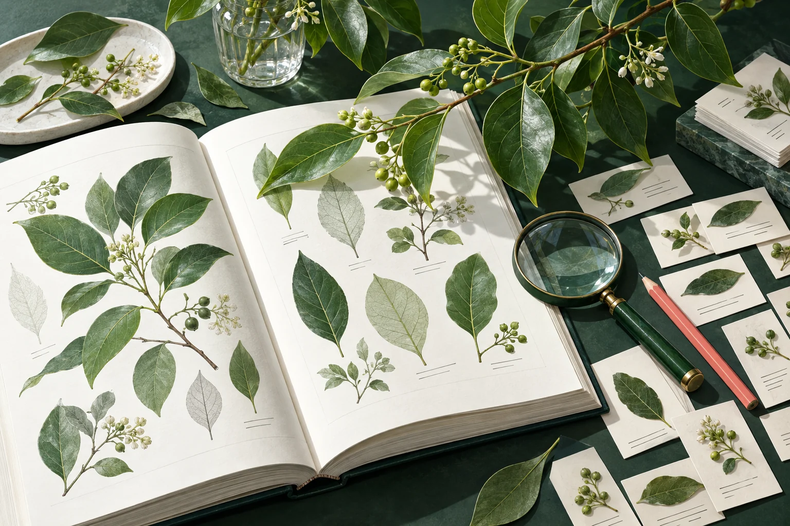
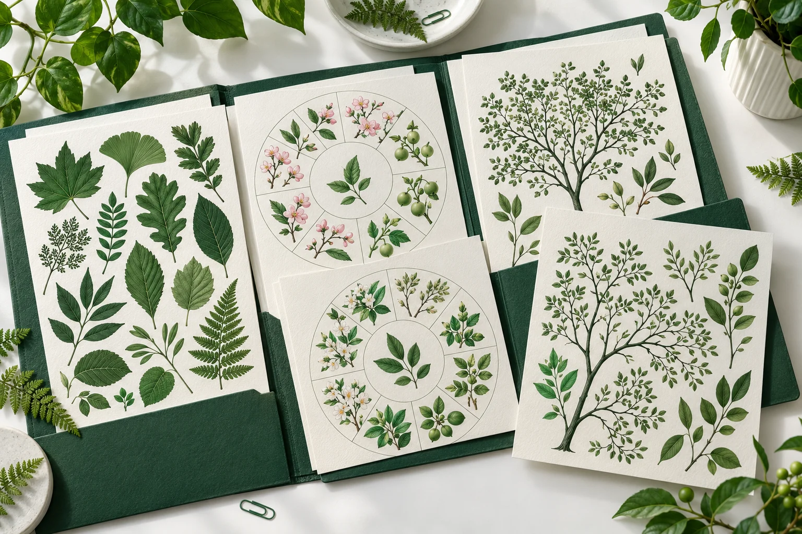
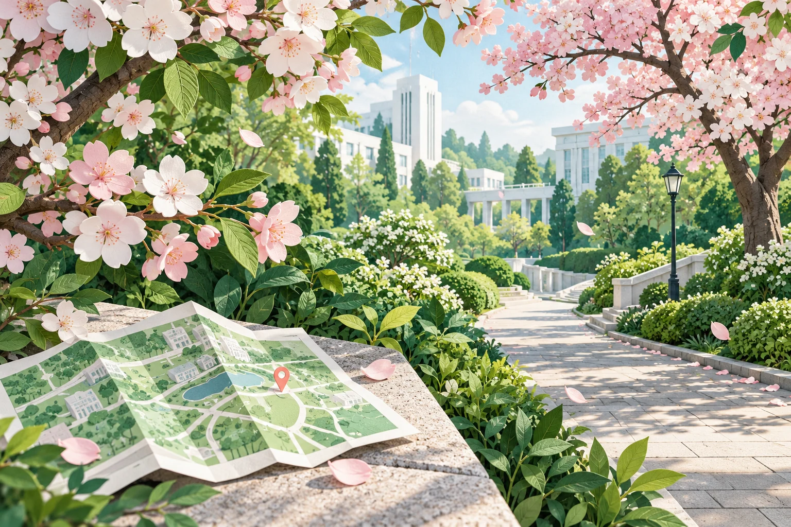
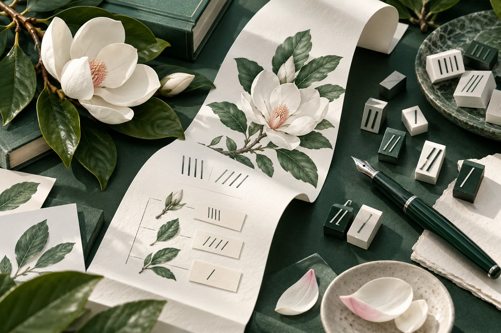

# 逐篇阅读与封面设计

2026-10-21，为站内全部 10 篇文章各绘制一张独立封面。先读原文，再提炼画面主题。樱花文章和分类学入门文章中的手写图文也逐页阅读，分别包含 18 张和 28 张配图。

统一采用植物纸艺与柔和立体质感，以叶绿、深绿、白色为主，少量花瓣粉与珊瑚粉点缀。封面是主题插画，植物辨认与校园位置仍以原文、实拍照片和调查数据为依据。文字标题在 HTML 中呈现，图片不嵌入标题。

## 文章与画面

| 文章 | 阅读后提炼的内容 | 封面构思 |
| --- | --- | --- |
| 《中国植物志》植物中文正式名的订正 | 从重名、种下等级名称到正字，讨论在稳定使用基础上的名称订正 | 植物字典、待校订的标本签、放大镜与樟树枝 |
| 《中国植物志》植物中文正式名读音的统一 | 多音字、罕用字、儿化轻声及文白读，构成读音整理的几个层次 | 不同叶形之间流动的白色语音曲线 |
| 同济大学（四平路校区）植物资源合集 | 植物名录、花期、果期、按科与按目的系统树，共五类资料 | 打开的绿色资料夹，五张不同的植物资源页 |
| 地图纪 · 樱花樱花想见你 | 从樱花大道走向更安静的赏花处，辨认东京樱花与关山樱，并记录毕业时节的心情 | 樱花掩映的校园小路、折叠地图与一枚位置标记 |
| 校园里的植物地标们（一） | 26 种植物地标的前 13 种，强调位置与辨认特征，例如布迪椰子和鹅掌楸 | 从地图上展开的校园，羽状棕榈叶与鹅掌楸形叶片 |
| 校园里的植物地标们（二） | 后 13 种植物地标，以七叶树叶片、栾树蒴果等线索继续寻找 | 七片小叶与珊瑚色纸质果荚，下方延伸一条小路 |
| 植物调绘的日常 | 在底图上逐株编号，记录密集植物，数水杉时又遇见棕榈 | 夹板上的点位地图、铅笔、相机与纸上长出的水杉林 |
| 植物分类学入坑帖 | 从植物志、检索表、术语书到网站、应用、表格和图像资源，介绍入门资料 | 一本长出蕨、阔叶与草的图鉴，放大镜和手机相伴 |
| 献给阿济的新年礼物 | 除夕上线的植物网站，把逐株调绘、照片、分类和检索送给校园 | 打开的绿盒子里，展开一座植物地图小校园 |
| 植物学名及中文正名的书写规范 | 分类等级、正斜体、杂交符号、栽培植物名称、命名人与中文正字 | 钢笔、正斜笔画活字、标签纸卷与白色木兰花 |

原文位置为 `public/articles/<slug>/index.md`，手写内容在各文章的 `images/` 中。未改动原文、署名、图表、植物记录或历史表述。卡片简介与展示顺序单独维护在 [article-editorial.ts](../src/data/article-editorial.ts)。

## 封面一览

| 名称订正 | 名字读音 |
| --- | --- |
|  |  |
| 资源合集 | 樱花路线 |
|  |  |
| 植物地标一 | 植物地标二 |
|  |  |
| 调绘日常 | 分类学入门 |
|  |  |
| 新年礼物 | 书写规范 |
|  |  |

## 文件与生成方式

- 采用内置 GPT Image 工具逐张生成，每篇一份提示词，无 API/CLI 回退。
- 完整提示词保存在 [article-cover-prompts.json](article-cover-prompts.json)，包含主题、构图、色彩和限制。
- 10 张原始 PNG 与网页使用的 WebP 均保存在 [public/illustrations/articles](../public/illustrations/articles/)，每张 1536 × 1024。
- WebP 只进行网页编码优化，保持构图与尺寸。首页加 10 张封面共从 32,376,988 字节降为 3,604,788 字节，约减少 89%。页面首批两张封面优先加载，其余懒加载。
- [scripts/encode-illustrations.cjs](../scripts/encode-illustrations.cjs) 可重复编码，接受已安装的 `sharp` 包路径，不是日常构建的前置步骤。
